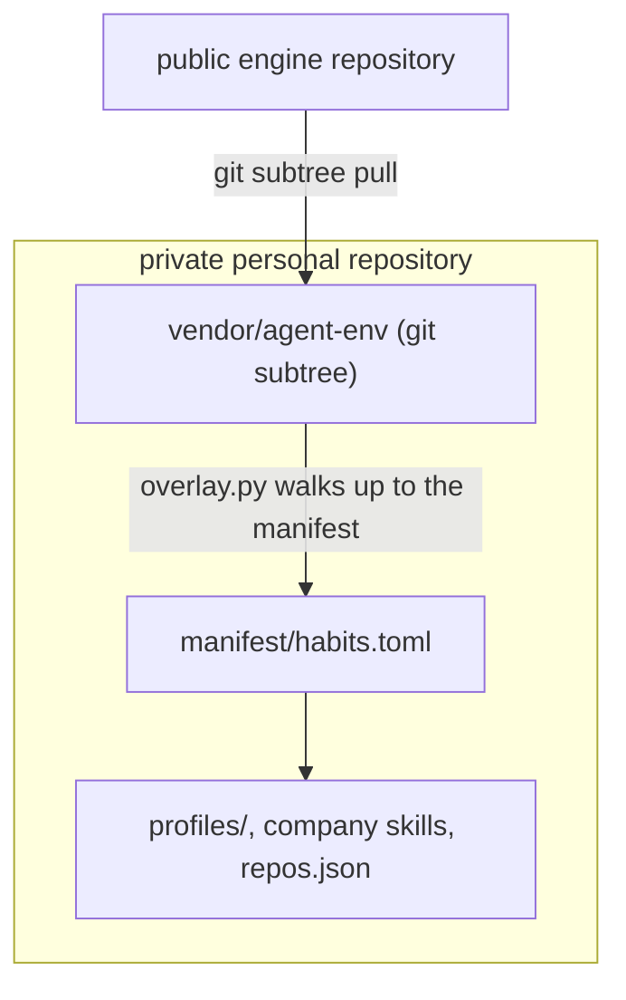
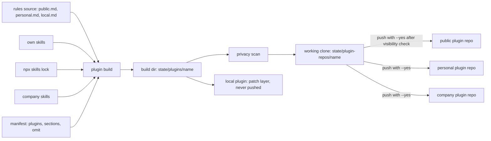
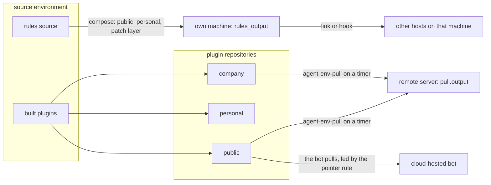
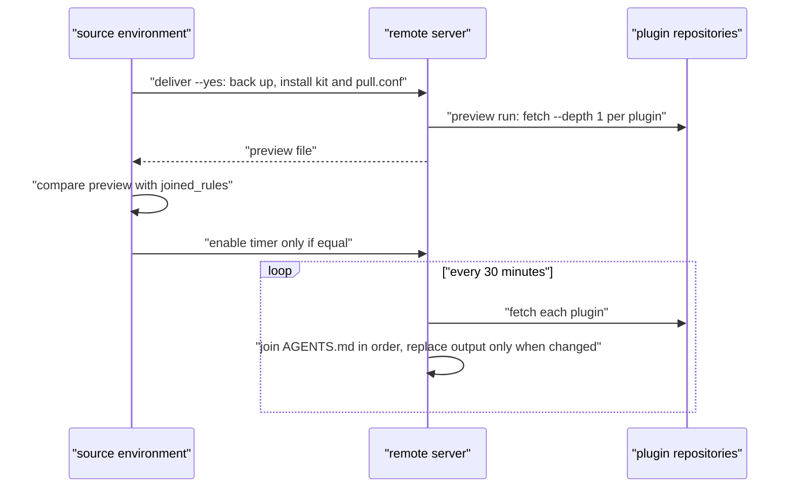
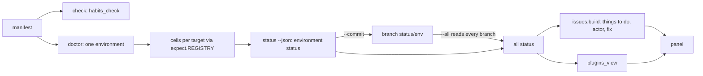
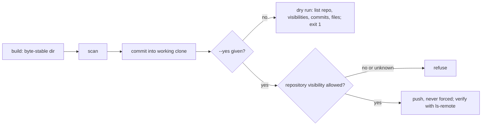

# Architecture

How agent-env is built: the problem it solves, the model, how data flows from the rules you edit to every
agent that reads them, and where to extend it. Terms are defined in [GLOSSARY.md](GLOSSARY.md); the plugin
design in detail is [docs/plugins-design.md](docs/plugins-design.md); the status JSON contract is
[docs/status-schema.md](docs/status-schema.md).

## 1. Problem and goals

One person runs many agents (Claude Code, Codex, Grok, pi, Cursor, Hermes, cloud chat bots) on many machines
(a laptop, a WSL install, a remote server, a vendor-hosted bot). Each host reads its rules and skills from a
different place, in a different format, with a different size limit. Copying rules by hand drifts, and the same
rules file mixes text that anyone may read with text that must never leave one machine.

Goals:

- **One source.** Rules are edited in one place, split by who may read them, and every target is derived from it.
- **Everything is a plugin.** Public and private differ only in which plugins a target installs.
- **Targets fetch, nothing is pushed into them.** A target this machine cannot write to still stays current.
- **Every target is checked.** One doctor reports every expectation of every target, with a fix for each finding.
- **Private by default, dry run by default.** Nothing without a visibility leaves the machine; nothing is pushed,
  installed remotely or replaced without `--yes` / `--write`.
- **Deterministic.** The same inputs give the same bytes; an interrupted run resumes and leaves no half-written file.

Non-goals: translating MCP, hook and permission formats between hosts (left to existing tools, ADR 0004), and
running a gateway in front of MCP servers.

## 2. Core concepts

| Concept | What it is | Where it is declared |
| --- | --- | --- |
| Manifest | `manifest/habits.toml` in the user's private repository: sources, environments, plugins, targets, expectations, MCP, rule sections | personal layer |
| Environment | one machine that runs agents; `transport` is local (default), `remote-exec` or `cloud-hosted` | `[environments.<name>]` |
| Target | one host in one environment, `id = "<env>/<host>"`; what it should receive and what doctor checks | `[[targets]]` + `[[targets.expect]]` |
| Plugin | a git repository of rules (`AGENTS.md`), own skills and third-party skill sources, with one visibility | `[plugins.<name>]` |
| Visibility | public (anyone), personal (owner and trusted cloud targets), company (colleagues), local (this machine; never pushed). Missing means local | plugin `visibility`; environments refuse some with `deny_visibility` |
| Sources | the rules source (`rules_src`: one Markdown file per owner, each `## ` section in exactly one file and registered in `[rule_sections]`), own skills, the `npx skills` lock, company skills | `[sources]`, `[rule_sections]` |
| Pointer rule | a short text (default limit 400 characters) stored in a cloud bot's memory that says which plugin repositories to pull, in what order, and what to do when a pull fails | `plugin pointer --target <id>` |
| Patch layer | the local plugin last in a target's list: whole sentences and sections that only hold on that machine; it appends to or overrides earlier sections | a `local` plugin with `rules_file` |
| `omit` | exact half-sentences a plugin drops from shared sections at build time; a target with a patch layer keeps them | plugin `omit` |
| Compose | merging a target's plugins in order into one rules file on the user's own machine | target `plugins` + `rules_output` |
| Pull | a remote server fetching its plugin repositories on a systemd timer and joining their `AGENTS.md` | target `pull = { dir, output, ... }` |

A target that does not use plugins yet can still be served by role: `render` writes a host-specific file from a
`supplement` (profile) followed by the shared sections whose roles match the target (`render = "generated"`).

### Where the personal layer lives

The engine holds no personal data. The user's private repository holds the manifest, profiles, private and
company skills and `repos.json`, and runs the engine either from a checkout (`AGENT_ENV_MANIFEST`,
`AGENT_ENV_REPO`) or vendored as a git subtree. `engine/overlay.py` finds the personal repository by walking up
from the engine's root (at most three levels) to the nearest `manifest/habits.toml`.

## 3. Data flow

### 3.1 From sources to plugin repositories

A build is byte-stable. It writes into a temporary directory beside the output under a per-output lock and
swaps it in with renames that roll back on failure, so an interrupted or concurrent build never loses the old
output or its `.git`. A plugin directory contains `AGENTS.md`, `skills/<name>/SKILL.md` for own skills, a
project `skills-lock.json` for third-party skills (recorded by upstream, never copied), `agent-env-plugin.json`
(name, version, visibility, environment variable names), and thin packaging for several hosts
(`.claude-plugin/`, `.cursor-plugin/`, the `pi` key of `package.json`), all pointing at the same `skills/`.

### 3.2 From plugins to each target

| Target kind | Transport | How it gets its rules | What doctor checks |
| --- | --- | --- | --- |
| a host on one of your own machines | local | `engine/compose.py` merges the target's plugins into `rules_output`; written by `render --target <id> --write` or by the environment's `sync_command`. Other hosts on the machine link to the file (`link`) or load it through a hook (`contains`) | `composed`, `plugins`, `link`, `contains` |
| a bot on your own machine that needs its own file | local | `render` writes `supplement` + sections selected by role into `output` / `also_output` | `generated` |
| a host on a remote server | `remote-exec` | `deliver --target <id> --yes` installs `features/plugin-pull/`; the systemd user timer runs `agent-env-pull` every 30 minutes | `pulled`, `service`, `login`, `secrets`, `company-skills` |
| a vendor-hosted bot | `cloud-hosted` | the user pastes the pointer rule into the bot's memory; the bot pulls the plugin repositories itself | `delivered` (pointer hash), `plugins`, `token` |

#### Compose (own machines)

Plugins merge in the target's order: a shared section sits once at its registered place; a later plugin that
carries it again leaves it (or replaces it if the text differs); a `rules_file` section with an existing
heading is appended to it; a new heading goes after the registered sections. Every carried-again, replaced,
appended or kept part is reported as 已覆盖 (overridden). The file starts with one header line naming the
sources and how to write it again.

#### Pull (remote servers)

A plugin that cannot be fetched keeps its last checkout (`result=stale`); one that was never fetched stops the
run and leaves the output alone (`result=failed`). The old output is backed up (newest ten kept). The puller's
status is `~/.local/state/agent-env/pull.status` on the host, which `kind = "pulled"` reads in one remote round
trip. Git credentials come from `env_file`, and only the variables named in `env_keys` are read.

#### Pointer rule (cloud-hosted bots)

`plugin pointer --target <id>` prints the rule; it fails if the text exceeds `pointer_limit_chars`. When a
plugin has third-party skills, the rule also says to run `npx -y skills experimental_install` in each repository
that has a `skills-lock.json`, with a git fallback. After the user stores it, `--record` keeps its hash and
`delivered` reports drift when the plugin list or a repository changes. A bot that reads a private plugin needs
a read-only token for that repository; the manifest records only its name and expiry date, and `token` warns
seven days ahead. Cloud-hosted environments are checked on their `driven_from` machine, because every check
reads that machine's state.

## 4. Engine module map

Everything in `engine/` is Python 3.11+, standard library only.

| Module | Role |
| --- | --- |
| `bin/agent-env` | shell entry; runs `engine/agent_env.py` with `AGENT_ENV_PYTHON` or `python3` |
| `engine/agent_env.py` | CLI: `check`, `render`, `doctor`, `status`, `rollback`, `deliver`, `eval`, `skills`, `promote`, `plugin`; environment detection, snapshots, status branches |
| `engine/overlay.py` | finds the personal repository (nearest `manifest/habits.toml` above the engine) |
| `engine/state.py` | the state directory: `$XDG_STATE_HOME/agent-env` or `~/.local/state/agent-env` |
| `engine/habits.py` | load the manifest, read and join the rules source, split `## ` sections, select sections by role |
| `engine/habits_check.py` | `check`: validates schema, rules, docs, hooks, targets, expectations, environments, MCP, names, git hosts, plugins; PASS / WARN / FAIL with a fix |
| `engine/render.py` | renders a target's file (supplement + sections by role, or compose); `--check`, `--write` after a snapshot |
| `engine/compose.py` | merges a target's ordered plugins into `rules_output` and reports overrides |
| `engine/plugins.py` | plugin contract and validation, build, privacy scan, publish ledger and steps, pointer rule, overrides, token state |
| `engine/frontmatter.py` | strict reader of SKILL.md front matter scalars (skill name and description limits) |
| `engine/collation.py` | ICU root collation for file names, so `skills-lock.json` hashes match `npx skills` |
| `engine/pull.py` | pull contract: `pull.conf`, the joined rules a remote host should have, the delivery steps |
| `engine/remote.py` | remote-exec transport: run one sh script through `exec`, send files in chunks through `send`, delivery records |
| `engine/company_skills.py` | copy company skills into a target's skill folder with backup and rollback; content hash shared with doctor |
| `engine/mcp.py` | compare the MCP servers a target should have with what its host config enables (per-host readers); read-only, `--plan` prints fixes |
| `engine/evals.py` | `eval`: behaviour spot checks per target through an external runner or a headless bot adapter |
| `engine/promote.py` | `promote scan` / `propose`: what hosts learned (memory, permission allows, new skills) as candidates for the sources |
| `engine/cells.py` | the five cell states (synced, customized, drift, missing, unknown) and the cell builder |
| `engine/issues.py` | turns status into things to do: who acts (`ACTOR_RULES`), wording (`TEMPLATES`), glossary |
| `engine/plugins_view.py` | data for the panel's plugin tab: repositories, build and publish state, what each environment gets; `plugin repos --refresh` caches repository visibility |
| `engine/expect/` | one module per expectation kind plus the `REGISTRY` (see section 9) |
| `engine/gitleaks.toml` | the engine's own gitleaks rules used when scanning plugins |
| `features/plugin-pull/` | `agent-env-pull` (POSIX sh), `agent-env-pull.service` and `.timer` (every 30 minutes) |
| `panel/` | the Environments panel (TypeScript, no dependencies): `source.ts` runs `status --json --all`, `model.ts` parses it, `page.ts` and `plugins-view.ts` render, `index.ts` is the portal handler, `dev-server.ts` serves it alone |
| `skills/agent-env/` | the runbook skill an agent follows to operate the engine |

Expectation kinds in `engine/expect/`: `link`, `contains`, `generated`, `delivered`, `login`, `service`,
`broken-links`, `company-skills`, `portal`, `secrets`, `plugins`, `token`, `pulled`, `composed`.

## 5. Check, doctor, status, issues, panel

- **check** never crashes: a malformed manifest becomes FAIL lines, each with `修复：…` (how to fix).
- **doctor** detects the current environment (`--env` overrides; remote-exec and cloud-hosted are never
  inferred), then checks every target in it. Local probes run in parallel. A remote-exec environment runs a
  `login` probe first; if it passes, every remote check is one sh script in one round trip; otherwise every remote
  cell is `unknown` and the environment carries an `error`.
- **status --json** is doctor's result in schema 1. `--commit` stores it on the local branch `status/<env>`
  with git plumbing only (the work tree, index and current branch are not touched); `--push` sends it.
  `--all` merges the live result, the cloud-hosted environments driven from this machine, and every other
  `status/<env>` branch, then adds `issues`, `glossary`, `relations` and `plugins_view`.
- **issues** decides who acts (user, AI, notice, another environment) from data tables; the panel never infers it.
- **panel** only reads `status --json --all` (or a fixture file via `AGENT_ENV_STATUS_FILE`) and renders tabs:
  to do, by machine, overview, relations, plugins. It is mounted by a local tools portal or served by
  `dev-server.ts`.
- **eval** runs behaviour spot checks and stores results in `state/eval/<env>.json`, which `status` reads.

## 6. Publish pipeline and privacy

`plugin publish (--plugin <name> | --all)` records each finished step in `state/plugins/publish-ledger.json`,
so a rerun resumes after the last done step.

- **Build** refuses content that may not enter the plugin: sections by their registered visibility, credential
  files and symlinks in skills, company skills outside company or local plugins, `omit` entries that are not
  found exactly, and (for public plugins) paths that point outside the plugin.
- **Scan** first checks that the build directory still hashes to what was built, then runs three layers on
  public and personal plugins: the engine's secret rules, home-path and email checks, and gitleaks on a staged
  copy without `.git` (required for public). A file that is not UTF-8 text must be a real image; anything the
  scanners cannot read is refused. Reviewed false positives are listed per plugin by line hash
  (`privacy_reviewed`); a changed line is reported again.
- **Commit** fetches the plugin's repository into `state/plugin-repos/<name>`, fast-forwards, mirrors the build
  (keeping `.git`) and commits only when the staged blobs equal the scanned build.
- **Push** asks the host whether the repository is public (`gh` for github.com; other hosts as
  `[git_hosts."<host>"]` declares). A personal or company plugin is never pushed to a public repository, and an
  unknown visibility never pushes.

Guarantees: local plugins and anything without a visibility never leave the machine; an environment's
`deny_visibility` is enforced by `check` and every build; secrets appear in the manifest by name only; doctor's
`secrets` kind only tests that names exist (`grep -q`) and file modes, never reads values.

Known limits (also in docs/plugins-design.md): the scan stops the usual spellings, not a deliberate bypass. A
JSON key and its value on separate lines, text hidden at an odd offset inside an image, a non-ASCII user name in
a percent-encoded path, and YAML anchors on the line after their key still pass. Read the diff yourself before
pushing anything public.

## 7. Generated files

- **Byte-stable.** Rendered, composed and built files carry no timestamps; the same inputs give the same bytes.
  Hosts that trust files by content hash depend on this.
- **Never edited by hand.** Every generated file starts with a header that names its sources and the command
  that writes it again. Doctor reports a hand edit as drift; the fix is to change the source and regenerate.
- **Snapshot before replace.** `render --write` copies the current file to
  `state/snapshots/<UTC time>/<target id>/` and writes atomically; `rollback` restores the latest snapshot.
  `deliver` backs up what it replaces on the remote host; `skills install` backs up before copying.
- **Runtime state is the target's.** A plugin update never touches a target's memory, secrets or working
  directory. Host configs are read, not rewritten: `mcp` and `skills_config` checks are read-only, and the one
  config the puller edits (`skills.external_dirs`) is set once after a backup. A personal layer that generates
  host config files the host also writes at runtime must extract that runtime state before regenerating and merge
  it back afterwards.

The state directory (`engine/state.py`) holds: `snapshots/`, `outbox/`, `deliveries/`, `eval/`,
`promotions/`, `plugins/` (builds and the publish ledger), `plugin-repos/` (working clones) and
`repo-visibility.json`.

## 8. Decisions

| ADR | Decision |
| --- | --- |
| [0003](docs/adr/0003-generic-environment-repo.md) | one engine serves every environment; the personal layer lives in its own private repository |
| [0004](docs/adr/0004-translate-formats-not-gateway.md) | external tools only translate host formats; MCP does not go through a gateway |
| [0005](docs/adr/0005-targets-pull-plugins.md) | every target is ordered plugins plus a patch layer, and targets fetch their plugins themselves |

Decisions 0001 and 0002 were about one person's setup and are not part of this engine.

## 9. Extension points

**A new host.** Most hosts need no code: add a `[[targets]]` entry with `host`, `roles`, the rule size limit
and the expectations that describe how it loads rules (`link` to the composed file, `contains` for a hook, or
`render = "generated"` with a `supplement` for its own file). To compare its MCP servers, add a reader to
`READERS` in `engine/mcp.py`; for behaviour checks, a case runner in `engine/evals.py`. Document the load path
in the profile (`profiles/_template/`).

**A new expectation kind.** Write one module in `engine/expect/` with `KIND`, `validate`, `check_local`,
`check_remote` (an sh fragment and a parser, a list of cells, or `None`), and optionally `env_errors` and
`GATES_REMOTE`. Add it to `REGISTRY` in `engine/expect/__init__.py`. If its findings need a specific actor or
wording, add rows to `ACTOR_RULES` / `TEMPLATES` in `engine/issues.py`. Add tests.

**A new target transport.** Transports are named in `[environments.<name>].transport`. A new one needs: how the
target receives plugins (a puller like `features/plugin-pull/`, or a pointer-like text), how doctor reaches it
(local, `engine/remote.py`, or only local state like cloud-hosted), validation in `habits_check.check_environments`
and `plugins.env_errors`, and an expectation kind that checks the result. Keep the rule that this machine never
pushes into a target: it builds and publishes, the target fetches.

**A new code host for plugin repositories.** Declare `[git_hosts."<host>"]` with a `command`, a `visibility`
regex and a `fail` regex; publish and the panel use it to ask whether a repository is public.
