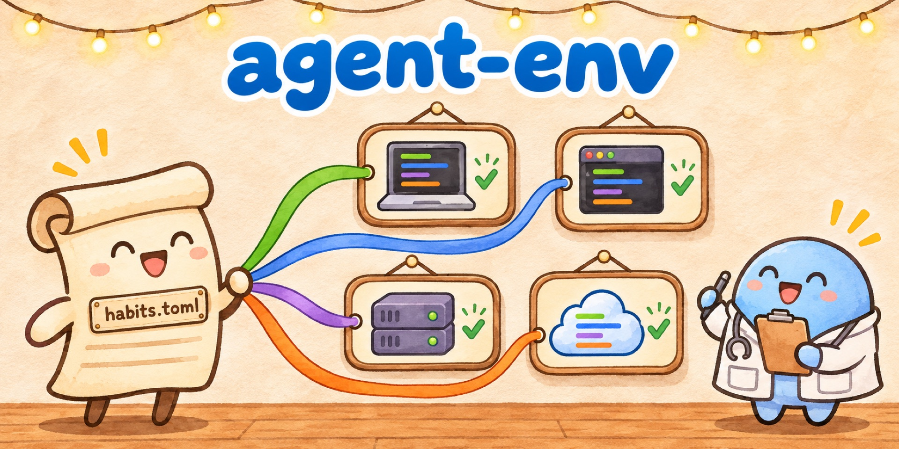
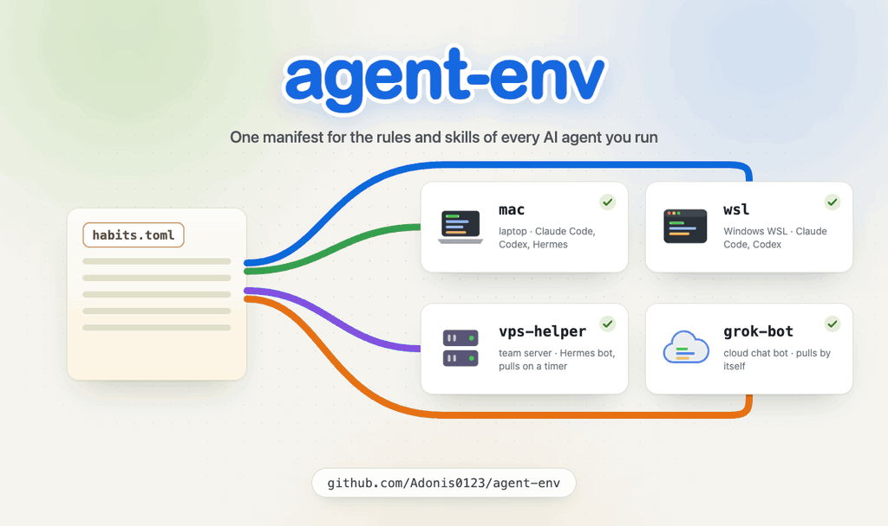
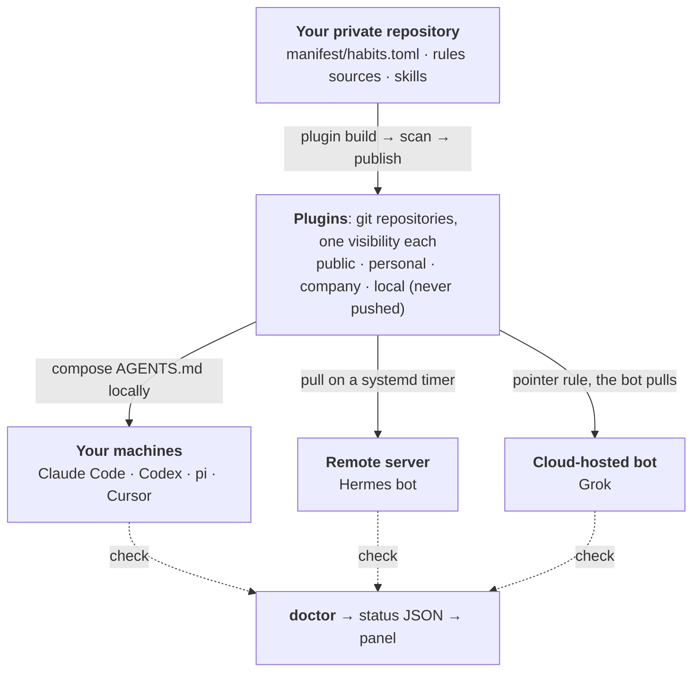
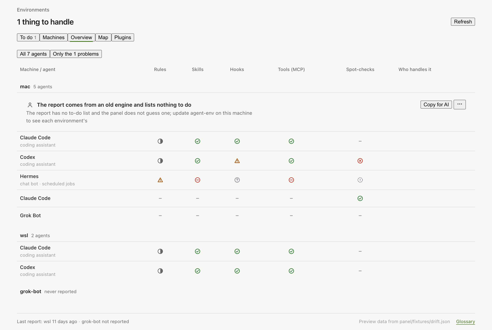

<p align="center">
  
</p>

<p align="center">
  <b>One manifest for the rules and skills of every AI agent you run, on every machine.</b><br>
  Claude Code, Codex, Grok, pi, Cursor, Hermes and cloud chat bots get their rules as plugins, and one doctor checks them all.
</p>

<p align="center">
  <a href="https://github.com/Adonis0123/agent-env/actions/workflows/privacy-scan.yml"></a>
  
  
  <a href="LICENSE"></a>
</p>

<p align="center">English | <a href="README.zh-CN.md">中文</a></p>

https://github.com/user-attachments/assets/8e01810b-c097-4acf-9569-0fa1f11717c8



## How it works



- **Edit once.** Rules live in one source, split by who may read them. Each target (one host on one machine) is
  an ordered list of plugins; later ones append to or override earlier ones, and every override is reported.
- **Targets fetch, nothing is pushed into them.** Your own machines compose locally, a server pulls on a timer,
  a cloud bot follows a short pointer rule.
- **Private and dry run by default.** Anything without a visibility stays local. Public and personal plugins are
  scanned for home paths, emails and secrets before they are written, and nothing is pushed without `--yes`.

How the engine is built: [ARCHITECTURE.md](ARCHITECTURE.md).

## Set up with your AI agent

You do not have to write code or type commands. Paste this to Claude Code, Codex or Grok Build:

> Set up agent-env for me. I do not write code, so run every command yourself and tell me in plain words what
> happened. (1) Create the folder `~/my-agent-env`, run `git init` in it, and clone
> https://github.com/Adonis0123/agent-env into `vendor/agent-env` inside it. (2) Open
> `vendor/agent-env/docs/guide/setup.md` and follow "Use it for your setup" (the folder and the clone are
> already done): copy `profiles/_template/starter/` into `~/my-agent-env` and fill in the manifest for this
> machine and for the agent you are running in. (3) Run `bin/agent-env check` until it shows no FAIL, then run
> `bin/agent-env doctor`. (4) Until I say yes, do not change any file outside `~/my-agent-env` and do not push
> anything. Then report: what you set up, what doctor found and what each finding means, which fixes you can
> make once I agree, and what I have to do myself.

The first run only reads and reports. The agent stops and asks before it writes an agent's rules file or pushes,
and leaves four things to you: saying yes, signing in, pasting a pointer rule into a bot's app, and creating
tokens ([details](docs/guide/setup.md#what-you-do-yourself)).

**One machine and one agent?** You do not need the engine. Install the public plugin
https://github.com/Adonis0123/agent-plugin-public in that agent instead ([how](docs/guide/setup.md#who-this-is-for)).

## Try the demo

Requires Python 3.11+ and git. `examples/demo/` is a made-up user with a Mac, a WSL box, a server bot and a cloud
bot ([the four environments](docs/guide/setup.md#the-demo)).

```sh
git clone https://github.com/Adonis0123/agent-env.git && cd agent-env
export XDG_STATE_HOME="$PWD/.demo-state"   # keep the demo's builds out of your real state directory
M=examples/demo/manifest/habits.toml

bin/agent-env check --manifest "$M"                                  # validate the manifest
bin/agent-env plugin build --all --manifest "$M"                     # build the five demo plugins
bin/agent-env render --target mac/claude-code --manifest "$M"        # print the composed AGENTS.md (no write)
bin/agent-env plugin pointer --target grok-bot/bot --manifest "$M"   # the pointer rule for a cloud bot
```

The panel shows every environment as a to-do list and a matrix (`npm --prefix panel test`, then
`AGENT_ENV_STATUS_FILE=panel/fixtures/v8-plugins.json node panel/dev-server.ts`):



## What `doctor` checks

Every expectation of every target: links, generated files, composed rules, plugins, services, logins, and
secrets by name only. Each finding ends with 修复： and the command that fixes it. All commands:
[docs/guide/commands.md](docs/guide/commands.md).

> Status: v0.1.0, extracted from a setup that runs on macOS, WSL, a Linux server and a cloud-hosted bot. The
> CLI's messages and some docs are in Chinese (zh-CN) for now; the code, the manifest keys and these docs are
> in English. The engine has no personal data in it: your manifest, profiles and private skills live in your
> own private repository.

## Docs

- [Set up](docs/guide/setup.md): who it is for, what you do yourself, the steps an agent follows, the demo
- [Commands](docs/guide/commands.md): every command, the repository layout, development
- [Architecture](ARCHITECTURE.md): concepts, data flow, module map, privacy, extension points
- [Plugins design](docs/plugins-design.md), [status JSON](docs/status-schema.md), [decisions](docs/adr/),
  [glossary](GLOSSARY.md)
- For agents: the runbook skill [`skills/agent-env/SKILL.md`](skills/agent-env/SKILL.md); rules for changing
  this repository in [`AGENTS.md`](AGENTS.md)

## License

[MIT](LICENSE)
