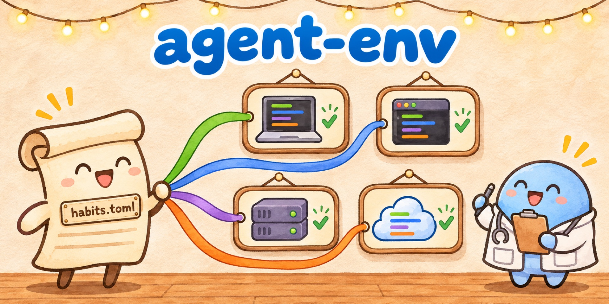
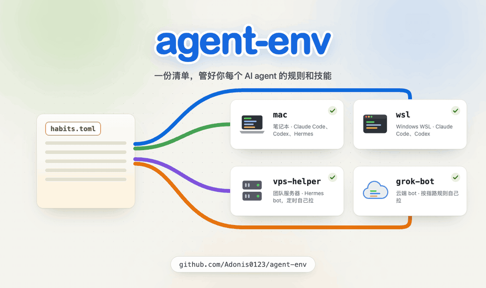
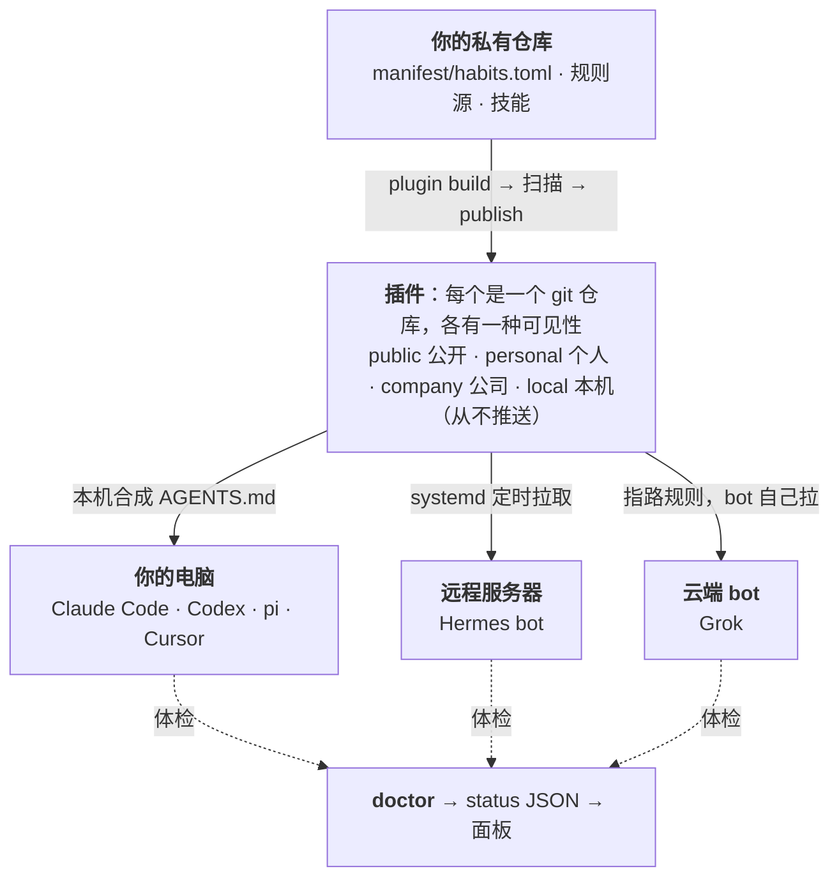
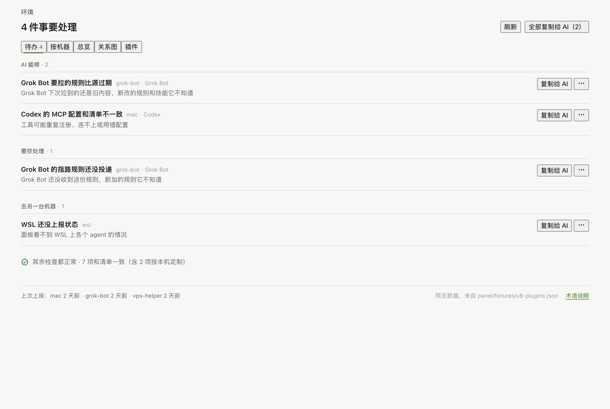

<p align="center">
  
</p>

<p align="center">
  <b>一份清单，管住每台机器上每个 AI agent 的规则和技能。</b><br>
  Claude Code、Codex、Grok、pi、Cursor、Hermes 和云端对话 bot 都按插件拿规则，一个 doctor 逐个体检。
</p>

<p align="center">
  <a href="https://github.com/Adonis0123/agent-env/actions/workflows/privacy-scan.yml"></a>
  
  
  <a href="LICENSE"></a>
</p>

<p align="center"><a href="README.md">English</a> | 中文</p>

https://github.com/user-attachments/assets/1892c19c-3a43-46d6-a52e-28c89b664790



## 怎么运作



- **只改一处。** 规则放在一个源里，按谁能看拆开。每个落点（target，一台机器上的一个 agent）是一串有序的插件，后面的追加或覆盖前面的，每次覆盖都会报出来。
- **落点自己取，不往里推。** 自己的电脑在本机合成；服务器按定时器拉；云端 bot 照一条指路规则（pointer rule，告诉 bot 去哪拉插件的一段短文字）自己拉。
- **默认私有，默认演练。** 没标可见性的插件只留在本机。公开和个人插件写出前，会扫描家目录路径、邮箱和密钥；不加 `--yes` 不推送。

引擎怎么搭的：[ARCHITECTURE.md](ARCHITECTURE.md)（英文）。

## 交给 AI 来装

你不用写代码，也不用敲命令。把这段话发给 Claude Code、Codex 或 Grok Build：

> 帮我装好 agent-env。我不写代码，命令都由你来跑，再用大白话告诉我结果。（1）新建目录 `~/my-agent-env`，在里面
> 运行 `git init`，把 https://github.com/Adonis0123/agent-env 克隆到它里面的 `vendor/agent-env`。（2）打开
> `vendor/agent-env/docs/guide/setup.md`，照「Use it for your setup」做（目录和克隆已经有了，不用重复）：把
> `profiles/_template/starter/` 复制到 `~/my-agent-env`，按这台机器和你现在所在的 agent 填好清单。（3）运行
> `bin/agent-env check`，直到没有 FAIL，再运行 `bin/agent-env doctor`。（4）我说可以之前，不要改
> `~/my-agent-env` 以外的任何文件，也不要推送任何东西。最后告诉我：装了什么、doctor 查出了什么、每一条是什么意思、
> 哪些等我同意后你能修、哪些要我自己做。

第一次运行只读文件，然后给你一份报告。下面四件事 AI 替不了你，它会停下来等你：

- **点头或拒绝**：AI 要写某个 agent 自己的规则文件（如 `~/.claude/AGENTS.md`）或推送之前，会先问你。在那之前所有写入都只是演练。
- **登录**：建私有仓库或发布插件前登录 GitHub（`gh auth login`）；doctor 报登录过期时，登录远程服务器或 agent CLI。
- **在 app 里粘贴**：云端 bot 要的那条指路规则，由你粘贴进 bot 的 app 并在里面确认。
- **建 token**：读私有插件用的只读 token 由你创建，也由你交给 bot。

**只有一台机器、一个 agent？** 不用装引擎，在那个 agent 里装公开插件就够了：
https://github.com/Adonis0123/agent-plugin-public （公开的协作规则和通用技能，由 agent-env 生成；Claude Code、Codex、Grok Build、Copilot 都能直接安装）。把这句话发给你的 AI：

> 帮我安装这个插件：https://github.com/Adonis0123/agent-plugin-public （marketplace 名 `adonis-public`，插件名
> `adonis-public`）。装完用大白话告诉我它加了什么、以后怎么卸载。

给 agent 的具体命令见 [setup.md](docs/guide/setup.md#who-this-is-for)。宿主要用户确认安装时，那一下由用户本人点。

## 跑一下演示

需要 Python 3.11+ 和 git。`examples/demo/` 是一个虚构用户，有一台 Mac、一台 WSL、一个服务器 bot 和一个云端 bot（[四个环境说明](docs/guide/setup.md#the-demo)）。

```sh
git clone https://github.com/Adonis0123/agent-env.git && cd agent-env
export XDG_STATE_HOME="$PWD/.demo-state"   # 演示产物不进你真实的 state 目录
M=examples/demo/manifest/habits.toml

bin/agent-env check --manifest "$M"                                  # 校验清单
bin/agent-env plugin build --all --manifest "$M"                     # 构建五个演示插件
bin/agent-env render --target mac/claude-code --manifest "$M"        # 打印合成后的 AGENTS.md（不写入）
bin/agent-env plugin pointer --target grok-bot/bot --manifest "$M"   # 给云端 bot 的指路规则
```

面板把所有环境列成待办和矩阵（先 `npm --prefix panel test`，再
`AGENT_ENV_STATUS_FILE=panel/fixtures/v8-plugins.json node panel/dev-server.ts`）：



## doctor 查什么

每个落点的每一项预期：链接、生成文件、合成规则、插件、服务、登录，以及只按名字查的密钥。每条发现以「修复：」结尾，后面是修它的命令。全部命令见 [commands.md](docs/guide/commands.md)（英文）。

> 状态：v0.1.0，从一套跑在 macOS、WSL、Linux 服务器和云端 bot 上的配置里抽出来。命令行提示目前是中文；代码、清单字段和文档是英文。引擎里没有任何个人数据：你的清单、档案和私有技能放在自己的私有仓库里。

## 文档

- [安装](docs/guide/setup.md)：适合谁、你自己要做的事、agent 的安装步骤、演示环境
- [命令](docs/guide/commands.md)：全部命令、仓库结构、开发
- [架构](ARCHITECTURE.md)：概念、数据流、模块、隐私、扩展点
- [插件设计](docs/plugins-design.md)、[status JSON](docs/status-schema.md)、[决策记录](docs/adr/)、[术语表](GLOSSARY.md)
- 给 agent：运维手册技能 [`skills/agent-env/SKILL.md`](skills/agent-env/SKILL.md)；改本仓的规则在 [`AGENTS.md`](AGENTS.md)

## 许可

[MIT](LICENSE)
