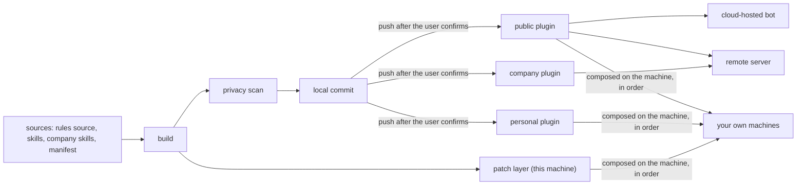

# Plugins: every target is ordered plugins plus a patch layer

Decision: `docs/adr/0005-targets-pull-plugins.md`. Terms: `GLOSSARY.md`. The demo in `examples/demo/` uses
every part described here.

## Goals

- Every agent environment (your own machines, a remote server, a vendor-hosted bot, someone else's machine) gets
  rules and skills through the same model: everything is a plugin.
- Public and private differ only in which plugins a target installs.
- The user speaks in plain language; an agent runs the commands, following `skills/agent-env/SKILL.md`.
- An interrupted run resumes; no half-written file is left behind.

## Model

### Visibility

| Visibility | Who may read it | Where it lives |
| --- | --- | --- |
| public | anyone | a public repository |
| personal | the owner and the cloud targets they trust | a private repository |
| company | colleagues and company machines | a private repository the company can read |
| local | this machine only | the patch layer; never pushed |

Anything without a visibility is local. The visibility belongs to the plugin, not to a section; a rules source is
split into plugins by section. An environment can refuse visibilities (`deny_visibility`): a shared team server
takes no personal plugin, a vendor's cloud takes no company plugin. `check` and every build enforce it.

### What a target gets (later plugins override earlier ones)

| Target | Plugins | How it gets them |
| --- | --- | --- |
| your own machines | public → personal → local (patch layer) | composed on the machine from the rules source (`rules_output`); no plugin repository is pulled |
| a remote server | public → company | `agent-env-pull` on the server pulls the plugin repositories on a timer (`pull`) |
| a cloud-hosted bot | public | the bot pulls them itself, led by a pointer rule in its memory |
| someone else | the author's public plugin (optional) → their own | they install the framework |

When the patch layer overrides a section or a skill, doctor and the panel show it as 已覆盖 (overridden) with
the plugin it came from. If the overridden part changes upstream, doctor tells you; it does not follow on its own.

### What a plugin repository holds

- `AGENTS.md`: the plugin's rules. Host plugin formats cannot carry always-on rules, so the engine delivers the
  rules to each host; cloud bots read the file directly.
- Skills: own skills in `skills/<name>/SKILL.md` ([Agent Skills](https://agentskills.io/specification): name up
  to 64 characters, description up to 1024, body best under 500 lines). Third-party skills are recorded by source
  only, in the `npx skills` project lock format (upstream and path), never copied.
- `agent-env-plugin.json`: name, version, visibility, the environment variable names it needs (never values).
- Packaging: the Claude Code plugin layout (`.claude-plugin/plugin.json` and a one-plugin `marketplace.json`,
  which Claude Code, Codex, Grok Build and Copilot install directly), plus `.cursor-plugin/plugin.json` and the
  `"pi"` key of `package.json`, all pointing at the same `skills/`.

A plugin carries rules, skills and, later, hooks and MCP servers. A target's own memory, secrets and working
directory belong to the target; a plugin update never touches them. No credential goes into any plugin.

## Which plugin a rule belongs to (一条规则归谁)

A rule belongs to the plugin of what it mentions. A sentence that names a local document, a local tool or a
service only one account has does not go into a public plugin. The test: would the sentence still hold on
another machine, for another person?

- Whole sentences and sections that only hold on one machine go into that machine's patch layer: a section of
  the patch layer's `rules_file` with the same heading is appended to the upstream section when composing.
- `omit` handles half-sentences, where moving the text to the patch layer would change the bytes the author's
  own machines read. It lists exact substrings to drop from the sections a plugin takes:
  - each entry drops one occurrence; write it twice to drop two. A count mismatch, or a missing substring, stops
    the build with a fix, so a changed source never silently brings a sentence back;
  - an entry carries its own joining punctuation (`, see x`, not `see x`); the builder only tidies the lines it
    touched;
  - a cut that leaves empty brackets, doubled or leading punctuation, a trailing comma, an empty list item, a
    removed `## ` heading or a removed code fence is refused;
  - the omitted text is never written to any generated file; errors name the entry by number only.
- Paths outside the plugin: in a public plugin's Markdown and JSON, inline code and link targets must not point
  at files the plugin does not have (`~/…`, `../…`, `docs/…`, `scripts/…`, `skills/…`, anything ending in `.md`).
  Such a path stops the build with file, line and fix; personal and company plugins only warn. Plain file names,
  URLs, absolute system paths, slash commands and placeholders (`<name>`, `$VAR`, globs) pass.

Fix a path finding either way: add the half-sentence to `omit`, or put the document into the plugin (inside
an own skill's directory) and link it relatively.

## Compose

A target on one of your own machines lists `plugins` and `rules_output`. `engine/compose.py` merges the plugins
in order: a shared section sits once, at its registered place; a later plugin that carries it again leaves it
(or replaces it when the text differs); a `rules_file` section with an existing heading is appended to it; a
new heading goes after the registered sections. A target with a patch layer keeps the `omit` half-sentences.
The file starts with one header line naming the sources and how to write it again. An environment with
`sync_command` writes it on every sync (for example an assembler that reads the rules source from a clone);
elsewhere `bin/agent-env render --target <id> --write` does, after a snapshot.

## Pull

A target on a remote-exec environment lists `plugins` and `pull = { dir, output, env_file?, env_keys?,
skills_config? }`. `bin/agent-env deliver --target <id>` (a dry run until `--yes`) backs up what it replaces,
installs `features/plugin-pull/` (the puller and its systemd user timer), pulls once into a preview file and
enables the timer only when the preview equals what this machine expects. The puller fetches each plugin
(`git init` + `fetch --depth 1`, so a credential helper that reads `git remote -v` works), joins their
`AGENTS.md` in order, and replaces the output only when it changed, keeping the last ten versions. A plugin that
cannot be fetched keeps its last checkout (`result=stale`); one that was never fetched stops the run and leaves
the output alone (`result=failed`).

## Pointer rule

A cloud-hosted target gets `plugin pointer --target <id>`: about 300 characters telling it which repositories
to pull, in order, and what to do when a pull fails. The user pastes it into the bot's memory; after the user
confirms, `--record` stores its hash, and doctor reports drift when the plugin list or a repository changes.
A cloud target that installs a private plugin needs a read-only token for that one repository; the manifest
records only the token's name and expiry date, and doctor warns seven days ahead.

## Versions and failures

- Plugins follow their default branch and carry no version; doctor reports stale builds. Only this framework is
  released with tags.
- A build writes to a temporary directory and swaps it in only when everything succeeded.
- Publishing records each step (build, scan, commit, push) in a ledger; a rerun resumes after the last done step.
- Commit: each plugin has a working clone in the state directory whose remote is the plugin's `repo`. Each run
  fetches and fast-forwards to the remote's default branch (`main` for an empty repository), mirrors the build
  into it (`.git` kept), and commits only when the staged files hash the same as the scanned build. On
  github.com commits use the owner's noreply address; elsewhere the global git identity.
- Push is a dry run by default: it lists the repository, its visibility and the plugin's, the commits and files to
  push, and exits 1. `--yes` pushes. The repository's visibility is checked live first (github.com with `gh`,
  any other host as `[git_hosts."<host>"]` declares); a personal or company plugin never goes to a public
  repository, and an unknown visibility never pushes. Never a force push.
- A target that fails to update keeps what it had; a cloud bot uses its last pull and says it may be stale.

## Privacy scan: known limits

The scan of public and personal plugins has three layers: gitleaks, the engine's own secret rules, and the home
path and frontmatter checks. It stops the usual spellings, not a deliberate bypass. Known inputs that still
pass:

- a JSON key and its value on separate lines (`{"api_key":` then the value on the next line);
- text encoded at an odd offset inside an image;
- a non-ASCII user name in a percent-encoded home path;
- YAML anchors and aliases written on the line after their key.

Known false positives (rewrite the text when you meet them): an environment variable name of 20 or more
characters after a secret-like key, an indented comment under a frontmatter value, block-scalar text that starts
with `&`.

Run a separate public-repository scan and read the diff yourself before you push anything public.

## Migration stages

`status` and the panel show an environment that has not moved to plugins yet as legacy, with the stage that
moves it:

| Stage | What moves |
| --- | --- |
| 3 | remote servers: from files delivered by this machine to pulling the plugins themselves |
| 4 | your own machines: from reading the sources directly to composing from plugins |
